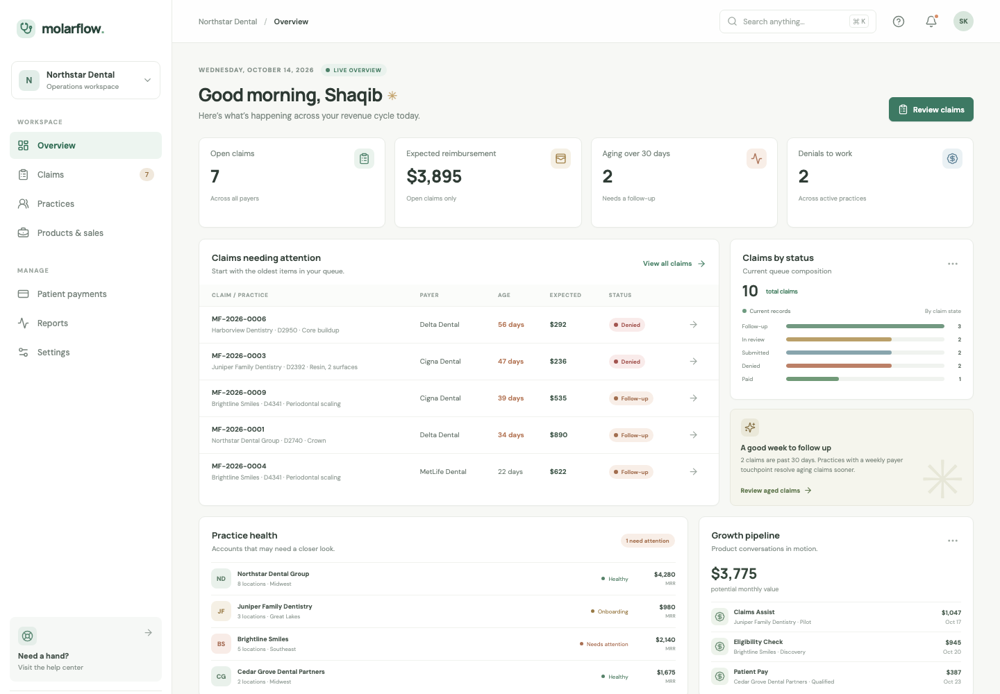
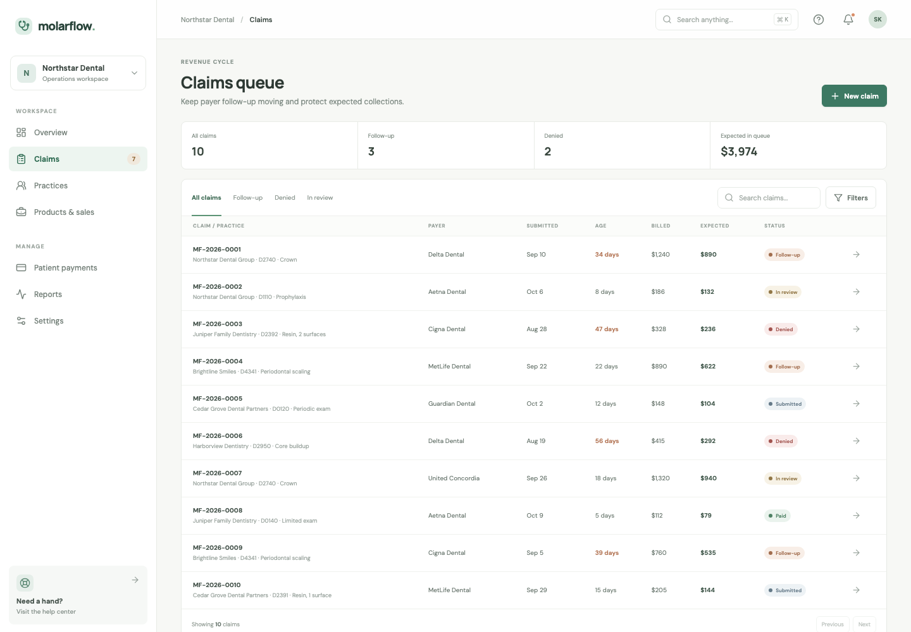
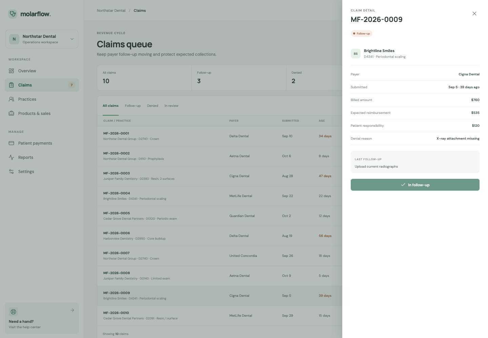
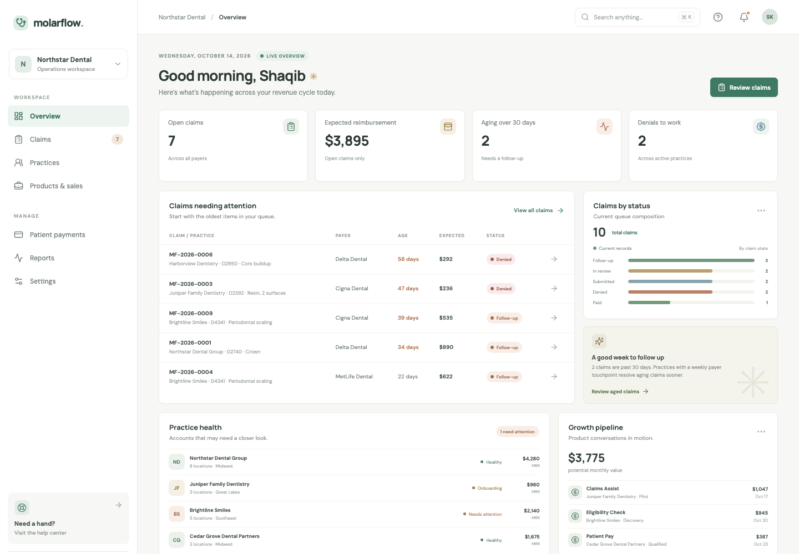
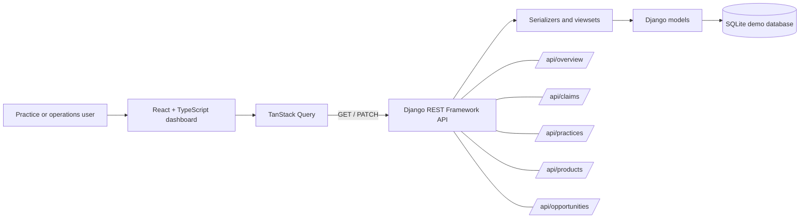
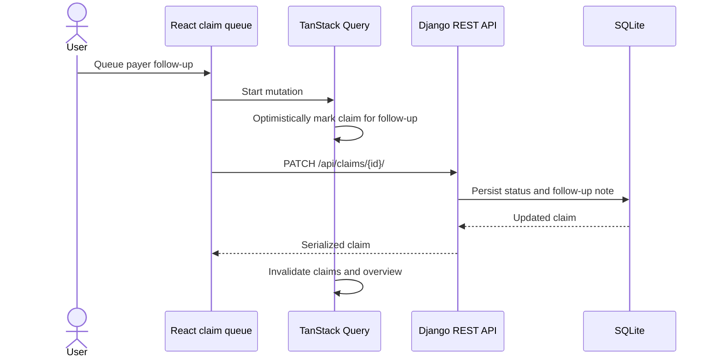

<!--
MolarFlow README
Project-specific documentation: claims and commands below were checked against the repository source.
-->

<div align="center">

# 🦷 MolarFlow

### The dental RCM workspace for claims, practice health, and product growth.

A portfolio project showing how a React frontend can coordinate real revenue-cycle workflows through a Django API.

[Explore the code](https://github.com/Skeeb32/molarflow-dental-rcm/tree/main/frontend/src) · [Open an issue](https://github.com/Skeeb32/molarflow-dental-rcm/issues/new) · [Read the API guide](#api-reference)

<br />

[](https://github.com/Skeeb32/molarflow-dental-rcm/stargazers)
[](https://github.com/Skeeb32/molarflow-dental-rcm/forks)
[](https://github.com/Skeeb32/molarflow-dental-rcm/issues)
[](https://github.com/Skeeb32/molarflow-dental-rcm/commits/main)
[](LICENSE)

<br />


</div>

> **For practices:** see which claims need attention and why.  
> **For customer and growth teams:** connect practice health to products, onboarding, and sales follow-up.  
> **For engineers:** inspect a typed React app using TanStack Query against a Django REST API.

MolarFlow uses fictional records for demonstration. It does not submit claims, connect to payers, or store real patient information.

---

## Try the live demo

**[Open the MolarFlow interactive demo](https://skeeb32.github.io/molarflow-dental-rcm/)** · [Browse the source](https://github.com/Skeeb32/molarflow-dental-rcm)

The public showcase runs as a static GitHub Pages build with the repository’s fictional seed records. Search, filters, navigation, and the follow-up interaction work in your browser; demo changes are in-memory and reset on refresh. To see the persistent Django API version, follow the local setup below.

## Visual tour

### Operations dashboard



### Claim queue and detail view

The screenshots and short walkthrough below are captured from the running demo. Open the [claims queue](https://skeeb32.github.io/molarflow-dental-rcm/?view=claims) or a [sample claim detail](https://skeeb32.github.io/molarflow-dental-rcm/?view=claim-detail) directly.

<details>
<summary>View the claims queue screenshot</summary>



</details>

<details>
<summary>View the selected claim detail screenshot</summary>



</details>

### Animated walkthrough



## What you can explore

| Revenue-cycle operations | Practice and product growth |
| --- | --- |
| Claims queue with status filters and search | Practice accounts with locations, onboarding stage, MRR, and next step |
| Claim aging, payer, procedure, denial reason, and expected amount | Product catalog for claims, eligibility, and patient-pay workflows |
| Queue a claim for payer follow-up | Sales opportunities linked to a practice and product |
| Dashboard metrics derived from Django records | Pipeline value and product adoption summaries |

**Demo dataset:** 5 practices · 10 claims · 3 products · 4 opportunities. These are deterministic, fictional records loaded by the Django `seed_demo` command.

## Visual architecture

The public GitHub Pages showcase is a client-side build for quick exploration. The diagrams below describe the Django-backed local application data path and claim follow-up interaction.

### Request and data flow



### Claim follow-up



## Why this project exists

Dental revenue-cycle teams work across payer responses, aging claims, denial reasons, patient responsibility, and practice follow-up. Customer teams also need a clear view of practice health and product adoption.

MolarFlow brings those two views into one small, inspectable application. The project is designed to demonstrate frontend ownership and a concrete Django/TanStack Query integration. It is a portfolio MVP, not a production billing platform.

## Engineering highlights

- **Server state with TanStack Query v5.** Query keys separate the overview, claims by status/search, practices, products, and opportunities. The client uses a 30-second stale time, one retry, and disables refetch-on-focus.
- **Optimistic claim follow-up.** The mutation updates cached claim lists, restores prior cache data on error, updates the open detail view on success, then invalidates claims and overview data.
- **A real API boundary.** Django REST Framework owns the records and aggregate metrics; the UI fetches them through a small typed API module.
- **Purposeful domain models.** Practices connect to claims and opportunities; opportunities connect practices to catalog products.
- **Search and filters live at the API.** Claim status and search parameters are passed to Django, with search across reference, payer, procedure, and practice name.
- **Accessible interface states.** Navigation uses buttons, controls have labels, tables include loading and empty states, and claim details open in a labeled drawer.

### Stack and responsibilities

| Layer | Tools | Responsibility in this project |
| --- | --- | --- |
| Web app | React 18, TypeScript, Vite 5 | Responsive dashboard and practice, claim, product, and sales views |
| Server state | TanStack Query v5 | Fetching, caching, optimistic mutation, rollback, and invalidation |
| API | Django 4.2+, Django REST Framework, django-filter | Claim, practice, product, opportunity, and overview endpoints |
| Data | SQLite | Local demo database and seeded sample records |
| UI | CSS, Lucide React | Layout, responsive styles, and interface icons |

**Django is used as an API backend here.** The pages are rendered by React; this repository does not implement Django server-rendered templates.

## Quick start

### Prerequisites

- Python 3.8 or newer
- Node.js 18 or newer
- npm
- SQLite (included with most Python installations)

### 1. Clone the repository

```bash
git clone https://github.com/Skeeb32/molarflow-dental-rcm.git
cd molarflow-dental-rcm
```

### 2. Install and start Django

```bash
cd backend
python -m venv .venv
```

Activate the environment:

```bash
# macOS / Linux
source .venv/bin/activate

# Windows PowerShell
.venv\Scripts\Activate.ps1
```

Install the API dependencies, apply migrations, load the demo records, and run Django:

```bash
python -m pip install -r requirements.txt
python manage.py migrate
python manage.py seed_demo
python manage.py runserver
```

The API is available at [http://localhost:8000/api/](http://localhost:8000/api/).

> **Seed command note:** `seed_demo` clears the demo-domain tables for practices, claims, products, and opportunities before recreating the sample dataset. Run it against a local demo database only.

### 3. Install and start the React app

Open a second terminal from the repository root:

```bash
cd frontend
npm ci
npm run dev
```

Open [http://localhost:5173](http://localhost:5173). Vite proxies `/api` requests to Django at `http://127.0.0.1:8000`.

### Build the frontend

```bash
cd frontend
npm run build
npm run preview
```

The production bundle is written to `frontend/dist/`. GitHub Actions builds and deploys the client-side showcase to [GitHub Pages](https://skeeb32.github.io/molarflow-dental-rcm/).

## Usage

### Explore claims

- Choose **All claims**, **Follow-up**, **Denied**, or **In review** to filter the queue.
- Search by claim reference, payer, procedure, or practice name.
- Select a claim to inspect amounts, age, denial context, and the latest follow-up note.
- Queue follow-up to update the claim status through the API.

Example API requests:

```bash
# Overview metrics
curl http://localhost:8000/api/overview/

# Claims in follow-up
curl "http://localhost:8000/api/claims/?status=follow_up"

# Search claims by payer, procedure, practice, or reference
curl "http://localhost:8000/api/claims/?search=Delta"

# Update one claim (replace 1 with an ID returned by the API)
curl -X PATCH http://localhost:8000/api/claims/1/ \
  -H "Content-Type: application/json" \
  -d '{"status":"follow_up","follow_up_note":"Call payer about missing narrative"}'
```

### Explore customer and sales data

- Open **Practices** to review locations, account stage, MRR, products, and next step.
- Open **Products & sales** to review the catalog and opportunities by stage, owner, value, and due date.

These views are read-only in the current MVP. The claim endpoint supports `GET` and `PATCH`; practice, product, and opportunity endpoints are read-only.

## API reference

| Method | Endpoint | Behavior |
| --- | --- | --- |
| `GET` | `/api/overview/` | Claim counts, aging, open expected reimbursement, practice count, pipeline value, and counts by status |
| `GET` | `/api/claims/` | List claims; accepts `status` and `search` query parameters |
| `PATCH` | `/api/claims/{id}/` | Update claim fields such as status and follow-up note |
| `GET` | `/api/practices/` | List practice accounts; supports search |
| `GET` | `/api/products/` | List products |
| `GET` | `/api/opportunities/` | List opportunities; accepts `stage` and `product` filters |

Django REST Framework's browsable API is available at the same local API URLs.

## Configuration and project layout

No environment file is required for the local demo. Django currently uses SQLite and a development-only secret in `backend/config/settings.py`; replace the secret and configure production settings before deployment. CORS is configured for the local Vite origins.

```text
backend/
├── config/                 # Django settings, URLs, ASGI and WSGI entry points
└── rcm/
    ├── management/         # seed_demo management command
    ├── migrations/         # initial schema
    ├── models.py           # Practice, Claim, Product, Opportunity
    ├── serializers.py      # API representations
    └── views.py            # viewsets and overview aggregate
frontend/
└── src/
    ├── api.ts              # typed API client and response types
    ├── App.tsx             # navigation, pages, queries, mutation
    ├── main.tsx            # React root and QueryClient configuration
    └── styles.css          # responsive visual system
```

## Validation

The frontend build runs TypeScript's project build before Vite bundles the application:

```bash
cd frontend
npm run build
```

The repository does not yet include an automated test suite. GitHub Actions builds and deploys the static showcase when frontend files change. For a local smoke check, start both servers and verify:

1. The overview loads metrics and demo records.
2. Claim status tabs and search update the queue.
3. A follow-up mutation persists after a refresh.
4. Practice and product/sales pages display their seeded data.

## Roadmap

### Implemented

- [x] React + TypeScript dashboard
- [x] TanStack Query resource queries and optimistic claim follow-up
- [x] Django REST API and initial SQLite schema
- [x] Seeded fictional practices, claims, products, and opportunities
- [x] Search/filter workflows and responsive practice, claims, and sales views

### Planned

- [ ] Authentication, roles, and practice-level tenant isolation
- [x] GitHub Actions build and GitHub Pages deployment for the interactive showcase
- [ ] Automated API and UI workflow tests
- [ ] CI checks for migrations and tests
- [ ] Write workflows for practice onboarding and sales opportunities
- [ ] Production database and deployment configuration
- [ ] Real clearinghouse integrations, only after security, privacy, and workflow review

## Contributing

Contributions are welcome. Start with a focused issue or open a discussion in a GitHub issue before making a larger change.

1. Fork the repository and create a branch from `main`.
2. Follow the [Quick start](#quick-start) to run both services.
3. Keep changes scoped and update documentation when behavior changes.
4. Run `npm run build` before opening a pull request.
5. Include a concise description, screenshots for UI changes when available, and steps to verify the change.

Please do not use real patient records, credentials, or production billing data in issues, examples, screenshots, or pull requests.

## For recruiters and engineering teams

MolarFlow demonstrates an end-to-end feature slice across a typed React UI and a Python API:

- Building a domain-oriented frontend across operations and customer-growth workflows.
- Integrating TanStack Query for remote data, cache updates, optimistic UI, rollback, and invalidation.
- Modeling relational business entities in Django and exposing them with DRF serializers and viewsets.
- Implementing API-backed search, filters, aggregates, and seeded demo data.
- Documenting scope and limitations clearly: this is an API-backed portfolio MVP, not production billing software.

The project does **not** claim live payer integrations, HIPAA readiness, production scale, or performance benchmarks. The GitHub Pages showcase uses in-memory synthetic data; the persistent Django API runs locally.

## Project metrics

These are repository/demo facts, not production usage metrics:

- **4** domain models: Practice, Claim, Product, Opportunity
- **6** documented API routes
- **5 / 10 / 3 / 4** seeded practices / claims / products / opportunities
- **1** claim update workflow with optimistic client feedback

Live repository activity is available through the badges at the top of this page. No release, star, contribution, or usage total is asserted here.

## License

MolarFlow is released under the [MIT License](LICENSE).

---

<div align="center">

### If this project is useful, give it a ⭐

Explore the source, fork it for your own learning, or open an issue with a focused improvement.

[⭐ Star MolarFlow](https://github.com/Skeeb32/molarflow-dental-rcm/stargazers) · [🍴 Fork the repo](https://github.com/Skeeb32/molarflow-dental-rcm/fork) · [💬 Open an issue](https://github.com/Skeeb32/molarflow-dental-rcm/issues/new)

</div>
